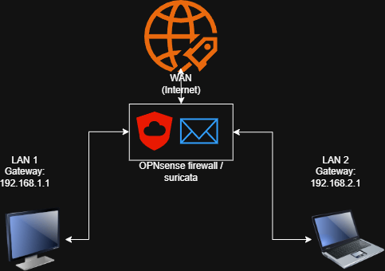
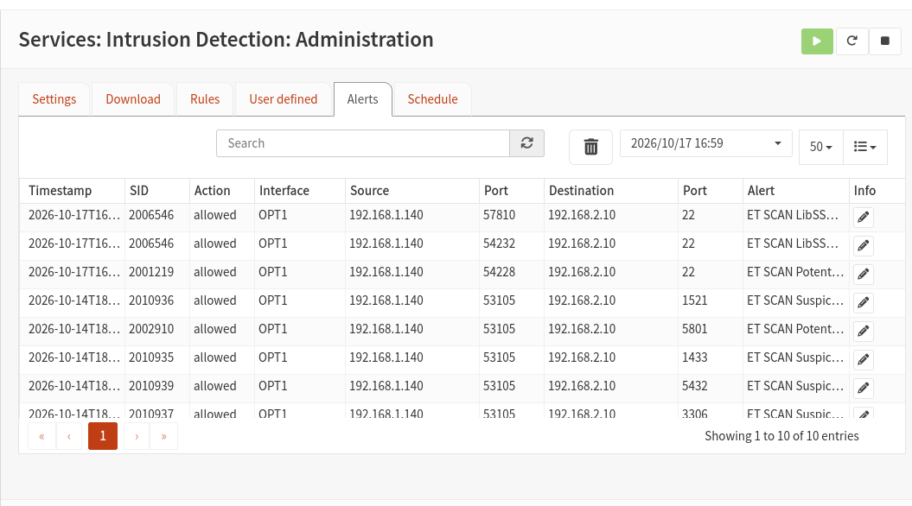
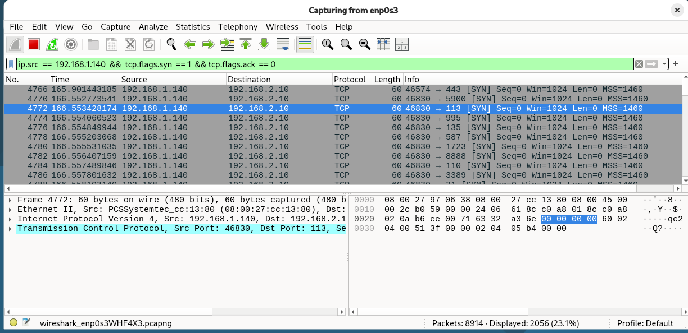

# Network Security Monitoring Lab

A SOC L1 home lab: I simulated a **port scan (Nmap)** and an **SSH brute-force attack (Hydra)** against a victim machine and detected both with **Suricata** on an **OPNsense** firewall, then confirmed the activity packet by packet in **Wireshark**.

## Network Diagram

Three VirtualBox VMs on two separate subnets, joined only by the OPNsense firewall:

| Role | Machine | IP address | Network |
|---|---|---|---|
| Attacker | Kali Linux | `192.168.1.140` | LAN (`192.168.1.0/24`) |
| Victim | Debian | `192.168.2.10` | OPT1 (`192.168.2.0/24`) |
| Firewall / IDS | OPNsense + Suricata | `192.168.1.1` / `192.168.2.1` | Between both networks |

Suricata runs in IDS mode on the OPT1 interface (the victim's network), and Wireshark captures traffic on the victim.

## Key Findings

**1. Port scan detected (Nmap `-sV`).** Suricata raised five `ET SCAN` alerts from `192.168.1.140`, each for a different service port (MSSQL, Oracle, MySQL, PostgreSQL, VNC). In Wireshark, 2,056 SYN-only packets of 60 bytes, one per destination port, about a millisecond apart, confirmed the scan.

**2. SSH brute force detected (Hydra).** Suricata raised `ET SCAN LibSSH Based Frequent SSH Connections Likely BruteForce Attack` (SID 2006546) for repeated connections to port 22, each from a different source port. Hydra (`rockyou.txt`) did not recover the password because the repeated connections were blocked; a manual SSH login with the known password then worked.

Suricata ran in IDS mode, so it only generates alerts and does not block traffic. Full analysis and triage conclusions: [Validation and Findings](documentation/04-validation-and-findings.md).

## Documentation

1. [Lab Overview](documentation/01-lab-overview.md)
2. [Network Architecture](documentation/02-network-architecture.md)
3. [Implementation Notes](documentation/03-implementation.md): configuration, and how I reviewed alerts and packets
4. [Validation and Findings](documentation/04-validation-and-findings.md): alert analysis and triage
5. [Evidence Index](documentation/05-evidence-index.md): every screenshot and what it shows

## Tools

OPNsense · Suricata · Wireshark · Nmap · Hydra · Kali Linux · Debian · Oracle VirtualBox

## Skills Demonstrated

- Intrusion detection with Suricata (IDS configuration, alert review)
- Alert triage: source, destination, signature, severity and conclusion
- Packet analysis with Wireshark (display filters, TCP flags)
- Network segmentation and firewall fundamentals
- Recognizing reconnaissance and brute-force attack patterns
- Technical documentation with evidence

## Disclaimer

This project was created for educational purposes in a personal virtual lab. All testing was limited to machines I own.
