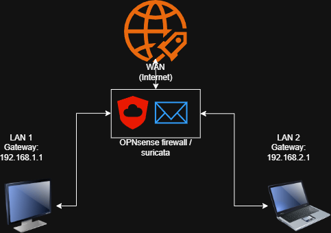

# 02 — Network Architecture

## Topology

Three virtual machines in Oracle VirtualBox:

- **OPNsense:** firewall/router with three interfaces (WAN, LAN, OPT1). Suricata runs here.
- **Kali Linux (attacker):** connected to the LAN segment.
- **Debian (victim):** connected to the OPT1 segment.

The attack path is:

`Kali Linux (192.168.1.140) → OPNsense LAN → OPNsense OPT1 → Debian (192.168.2.10)`

Because every packet between the two machines must pass through OPNsense, the firewall is the natural place to monitor it.

## Addressing Plan

Values taken from the OPNsense console and dashboard (see [Evidence Index](05-evidence-index.md)).

| OPNsense interface | Address | Purpose |
|---|---|---|
| WAN (`le0`) | `10.0.2.15/24` (DHCP) | VirtualBox NAT; gateway `10.0.2.2` |
| LAN (`le1`) | `192.168.1.1/24` | Network of the attacker (Kali) |
| OPT1 (`em0`) | `192.168.2.1/24` | Network of the victim (Debian) |

| Host | IP address | Segment |
|---|---|---|
| Kali Linux | `192.168.1.140` | LAN — `192.168.1.0/24` |
| Debian | `192.168.2.10` | OPT1 — `192.168.2.0/24` |

The OPNsense web interface was reached from the victim side at `http://192.168.2.1`.

## Monitoring Points

| Tool | Where it observes | What it sees |
|---|---|---|
| Suricata | OPNsense interface **OPT1** (PCAP live mode, promiscuous) | Traffic arriving at / leaving the victim network |
| Wireshark | Victim VM (Debian), interface `enp0s3` | Packets that actually reach the victim |

Using two monitoring points makes it possible to confirm one thing from both sides: Suricata **reports** the attack, and Wireshark **shows** the packets that caused the alert.

## Limits of this setup

Suricata only inspects the interface selected in its settings (OPT1). Traffic that does not cross OPT1 is not inspected.
